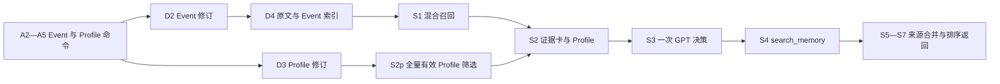
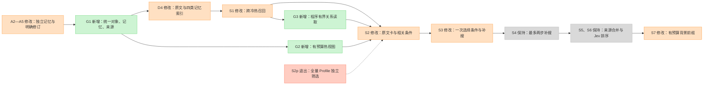

# A02 → 独立 G01 架构 diff

本项目为新建独立代码，不改动 TraceWeave A02。新增绿色、修改橙色、退出红色、保持灰色。下列退出只针对 G01 的设计范围。

## 改前：A02 受影响部分

## 改后：G01

红色节点展示退出项，虚线表示其原职责由有预算背景与一次 S3 决策承接。

## 变更清单

| 模块 | 原行为 → G01 | 原因与验收 | 文件 |
| --- | --- | --- | --- |
| A2—A5 | 两类操作 → 四类统一、具体声明、追加修订 | 独立新增、旧候选保持、局部修正与旧内容保留；真实语义身份另外验收 | engine.py、models.py、providers.py |
| A4 | 日期与来源契约 → 每条命令引文时间计算、最终日期局部降级 | 正确等价日期可接受；未知日期保留内容，来源错误独立处置 | clock.py、engine.py |
| G1 | D2／D3 组织 → 记忆、对象、来源与修订连接 | 关联范围有依据；权限与因果可见性检查 | models.py、storage.py |
| G2 | 当前 Profile 全量扫描 → 有预算热视图 | 保留旧有效条件；冷记忆仍检索；读取不刷新确认时间 | heat.py |
| D4、S1 | 原文与 Event → 原文及四类记忆跨冷热索引 | 冷区唯一证据可达，图缺失时原文仍可达 | storage.py、retrieval.py |
| G3 | 默认关闭主题组 → 程序沿来源和明确对象读取一层 | 有界 fanout；新增正确证据收益独立验证 | engine.py |
| S2、S3 | 全量合格 Profile → 有预算当前条件，同一次 GPT 选择相关项与补搜 | JSON 总预算与每卡原文保留；本次仅一个决策调用 | engine.py、providers.py |
| S2p | Jev 独立全量筛选 → 退出 G01 | Jev 保持专注 reranker，控制语义调用范围 | providers.py |
| S7 | 完整 Profile 重复前缀 → 有预算任务相关前缀 | 输出证据来源明确，背景不挤占 Top K | engine.py |

模型输入继续使用整条来源 ID；静态 schema 保留 operation、目标、具体内容、来源、对象、时间和声明状态，来源 ID 由输入数据提供。无动态编号枚举，无自评来源／身份字段。时间规则、未知降级、调用数和空间预算均以所属模块记录。

模型调用：每处理单元一次 GPT 抽取＋最多一次共享修正；Search 一次 GPT 决策＋最多两步补搜；Jev 仅证据重排。冷热计算与图关系读取为程序操作。

数据库影响：新项目独立 6 表范围待明确批准后初始化；既有 TraceWeave 表和数据保持不变。保持项包括 HTTP 请求结构、供应商模型选择、BM25 算法、来源绑定方法、原文证据交付、有限重试和失败检查点。用于已有评测时钟 header 的兼容别名在评测迁移后删除。
