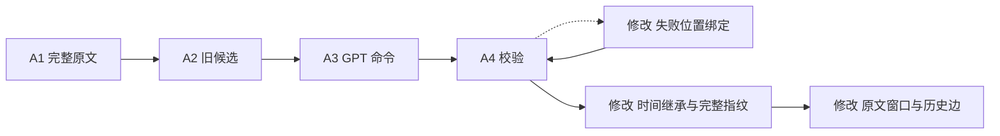
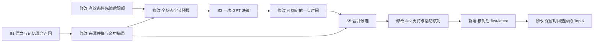

# 结构完整性修复

本次修复围绕修订、原文证据和查询约束的跨模块交接。原文保存、一次生成加一次共享修正、SQLite 六表、跨冷热混合召回和两步补搜保持。

## 架构图 diff

## 连接与预算

修正使用 RepairPlan，替换同一位置的失败命令。初始整个响应无效时，使用一次普通 Plan 再生成。时间未知降级继续使用已保留的原命令。

补搜的活动核对与普通排序共享 Jev 批次，Jev 的职责为证据排序判定。GPT 调用预算保持 Add 每单元最多两次逻辑调用、Search 一次逻辑调用。Jev 每批最多八张卡、两并发；额外活动问题数量随实际时间候选计量。

真实调用补充修复：S3 对每个工具步骤独立校验，保留有效步骤与背景选择，并记录错误位置；S4 消息时间锚点接受与已选来源元数据等价的 ISO 表达。消息时间和事件时间继续分别执行。完整 Add 数据冻结后，全部 Search 复测使用隔离数据库副本，结果保留独立代码指纹。

格式验收补充：A4 和 S3 的模型参数统一规范字符串空值，减少将缺失值当成日期的修正。日历支持英文月份与日粒度相对表达，日期字段与内容绝对化共享计算。A4d 对每个未知时间字段独立降级。代码冻结后再次执行完整 Golden，初次完整运行与 Search 复测仍保留。

退出：修正响应作为新操作任意追加、标题级修订去重、单文档覆盖式回合合并、相似候选直接选择最早时间、混排覆盖时间选择、事件占用背景名额后再删除。

## 验收边界

程序反例通过独立回归，SQLite 重启保留同样结果。Golden 使用固定原文、问题、参考时钟和 Top K；评分只读取可见且与输入原文一致的摘录。答案与证据标注留在测试侧。

同一记忆的语义身份仍由 GPT 判断。长期扫描性能、实体别名和完整计数保持独立验收边界。TraceWeave 使用已冻结的历史结果对照，代码及数据库保持原状。
