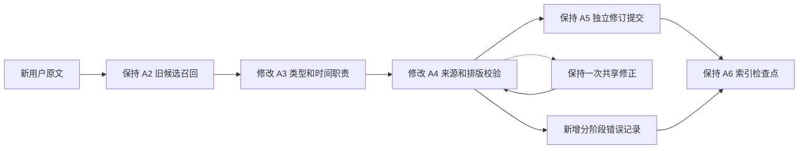
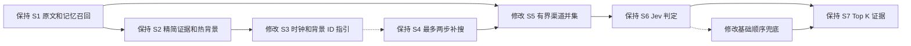
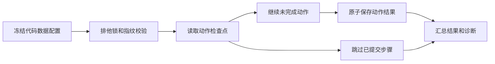

# EmberGraph 来源校验和 David 续跑优化

本次修改来源校验、时间锚点、候选分配和测试恢复。137 项离线回归通过；持续条件分类与补搜目标的真实改善由模型测试验证。主力模型、六表结构、冷热图、Jev 排序判定和调用上限保持原状。

## Golden 暴露的问题

上一版 Golden 严格原文召回 85.04%，完整证据命中 10/13。仍有工作坊错误前提、晨间快走、CrossFit 三道不完整题。

83 项未知时间处置分为 61 条 Event、13 条 Experience、9 条 Preference。Experience 全部 13 条、Preference 9/10 经历时间降级。102 条 Event 中，60 条最新修订的发生时间未知。Experience 和持续条件需要与事件日期分别定义职责。

7 月 12 日的卧床要求及后续诉苦因来源引用失败被处置。10 月 1 日拐杖活动进入 Event，摘要省略了拐杖。Fact 为 0 同时涉及来源、分类和内容提炼；旧日志无法拆分 28 次来源错误的原因。

三道题的 GPT 决策实际看到 12 张证据卡及 7、8、10 条当前条件。返回的背景 ID 来自事件证据，经过有效背景过滤后均为 0。最终候选池为 35、52、49 条；只有快走题达到旧 52 条上限，旧日志无法证明哪条证据被截掉。

## Add 架构 diff

A3 明确持续条件使用 Fact、当次发生使用 Event；用户明确表达二者时可输出独立命令。引文涵盖本条声明及其时间短语。Experience 使用来源观察时间，日期参数填空。Fact/Preference 填明确生效日期，其他情况由程序保留区间或记录声明时钟。上下文用于解指代和明确确认，格式调整请求可以返回空命令。

A4 先核对当前用户来源 ID，再定位引文。空白或弯直引号差异在唯一匹配时映射回真实来源，映射后重新校验字段长度。内容改写和多处等价匹配仍进入共享修正。时间针对本条引文解析，同句多个事件分别绑定日期。

原 requests 表单元 JSON 增加 validation，记录阶段、位置、kind、operation、错误类型、来源 ID 是否匹配和日期参数是否存在。来源错误、日期错误及最终降级可独立计数；该诊断字段只存执行元数据。

## Search 架构 diff

S3 区分当前条件 ID 与证据文档 ID；错误前提问题同时检查实际活动。消息时间用于读取日期对话，事件时间用于已绑定的发生日期。

S4 事件锚点仅读取以所选来源为主来源的事件日期。其他事件将它作为上下文时，沿用各自的主来源时钟。来源本身支持多个日期时继续记录歧义。

S5 保持每路 40 条检索及 12 条图邻域上限，基础与最多两路补搜合并后完整进入 Jev，退出统一截到 52 条的路径；自然上限 156 文档。完整评分统一排序；部分评分或供应商失败时保持原问题基础来源顺序，再追加补搜来源。已确认的 first/latest 选择继续保留。

日志增加渠道来源、决策展示来源、排序与有效评分数量、错误背景 ID 数量、兜底是否执行及实际新增数量。Jev 物理批次数可能增加，延迟与部分失败率由真实测试验收。评分问题、阈值和 Top K 本次保持冻结。

## David 运行和恢复

完整本地 David 为 75 天、1486 回合、215 次 Add、86 道 Search：13 道已知回归题和 73 道同人物其余题。72 道附件或混合题位于文本对话范围之外。输入按时间重放，答案和证据标签保留在评测侧。

固定目录保存 state.json、run.json、result.json、steps、memory.sqlite3、diagnostics.jsonl、http-attempts.jsonl。各动作结果使用临时文件、fsync 和原子替换提交。恢复核对服务与运行器代码、数据、非敏感模型配置、动作计划和对照指纹，沿用同一用户、请求 ID 和数据库。

完成 Add 读取 requests 检查点跳过；索引未完成时从已存计划继续。已提交 Search 从独立 step 文件恢复。整轮 complete 后再次 resume 直接读取结果，模型调用为 0。原子提交前中断的 Search、尚未存计划的抽取可能重执行，报告标注 unclean_resume_count 和物理调用完整性。

暂态 HTTP 或连接错误最多三次同载荷尝试；预算耗尽保留检查点并报告中断。永久认证或付费错误停止请求。恢复使用 run.json 记录的 resume_command。

## 验收标准和剩余问题

1. 离线回归覆盖引文、独立日期、锚点、渠道并集、部分排序失败、诊断、原子保存、排他锁、配置变化和本地 HTTP 恢复；已通过 137 项，模型调用为 0。
2. David 完成 215 Add、86 Search、1486 处理单元；六表结构、原文计分、物理调用、错误和延迟均可复核，旧结果保留。
3. 全部遗漏逐条定位到抽取、召回、决策、条件核对、排序或原文包装；相对历史 TraceWeave 区分持续遗漏、恢复和本轮新遗漏。
4. 13 道已知题与其余 73 道分别报告。这是同人物开发诊断和检索证据成绩。Golden 与完整 David 的历史长度不同，各自保留范围说明。

持续条件的真实分类、事件身份、未知时间、前一步多候选锚点、隐含限制和反证排序仍需模型测试验证。程序修复已经保护执行和候选覆盖，内容改善以实测为准。自动 combine、事件组、额外语义校验和 reranker 阈值调整位于本次范围之外。
