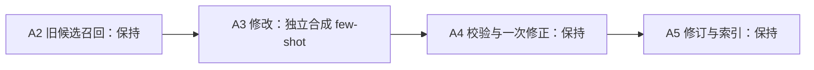

# EmberGraph 独立合成示例与更新诊断

本次替换 A3 的 few-shot：11 个独立合成例子以完整输入与 JSON 操作展示记忆选择。A1 至 A6 的执行链路沿用 G03。历史 Golden 使用 G02，保持原冻结代码、数据库和结果；本次以离线测试验收代码与示例契约，模型效果由独立后续评测验证。

## 架构局部变化

新增 `prompt_examples.py` 作为学习示例的唯一来源。`providers.py` 读取这些例子，原来的行内示例退出运行提示词。命令 schema、create/update/retract 定义、来源与时间校验、六张表、冷热、Search、模型和调用预算保持原状。Add 继续一次初始生成与最多一次共享修正。

示例覆盖无匹配新增、同一偏好改值和再次确认、同一发生补充结果、另一次独立发生、持续条件新增与解除、错误声明撤回、用户明确选择助手方案、格式请求保留原文、明确经验归纳。示例中的 10 条命令包括 5 次 create、4 次 update、1 次 retract，另有一个空命令列表。

示例采用维护文档、滤芯测试、账号身份核验、窑炉资质、版式和上传校验等新合成场景。它们是提示词教学材料；模型效果测试使用另外保留的样例。单元测试检查完整 JSON、来源与目标绑定、操作和类型覆盖及提示词字节上限。

## 上一轮操作计数

G02 RHELM 的 159 个用户处理单元接受 126 条命令：125 次 create、1 次 update、0 次 retract。33 个单元没有接受命令，最终错误为 28 次来源绑定或引文错误、5 次对象名称依据错误。83 次 `accepted_with_unknown_time` 保留了记忆，表示时间降级。自造生命周期样例另外包含 3 次 create 和 2 次 update，统计时与 RHELM 分开。

这些是最终接受的操作数。G02 记录缺少初始失败命令、原始候选清单和 Add 查询向量，无法按比例拆分全部潜在更新的失败原因。

## 更新案例与召回边界

历史审计逐回合核对原文和已接受命令，并选择 8 对回合做词法召回回放。回放按实际请求与处理顺序恢复已提交的原文、记忆修订和索引，使用 G02 的 A2 代码及 16 条文档上限，关闭向量查询。它说明词法渠道的行为，历史完整 BM25 与向量融合结果仍然未知。

| 回合 | 保存情况 | 词法回放与解释 |
| --- | --- | --- |
| 1 月 4 日第 1 至 2 回合 | 连续 create 两条相同早起偏好 | 旧原文排第 2，旧偏好文档排第 17，未进入前 16。已有原文上下文可以帮助理解，旧记忆 ID 可能未提供 |
| 1 月 4 日第 5 至 6 回合 | 对同次打包确认执行 update | 旧事件文档排第 1，实际 update 通过，说明更新路径可以执行 |
| 3 月 7 日第 13 至 14 回合 | 前条保存收到反馈后的感受；后条新建工作坊日期计划 | 回放能找到前条，但前条代表反馈发生，后续工作坊计划尚未独立保存。当前记录形态下新建计划有依据 |
| 5 月 5 日第 11 至 12 回合 | 同一次反馈及其后续细节保存成两个 Event | 旧原文排第 1，旧事件文档排第 2；新操作也绑定旧原文作为上下文。身份合并属于可疑遗漏，实际候选 ID 需要历史完整轨迹确认 |
| 5 月 30 日第 7 至 8 回合 | 改期同意消息被对象名称校验丢弃 | 词法回放能找到旧计划；失败操作的类型没有保留，无法确认原操作是否 update |
| 6 月 6 日第 1 至 2 回合 | 疼痛细节因来源错误丢弃 | 旧原文排第 1，旧事件文档排第 84；回放中旧记忆 ID 未进入候选，最终又存在来源校验失败 |
| 5 月 30 日第 7 回合与 6 月 1 日第 11 回合 | 后来修复音频并再次通话保存新事件 | 新通话有独立发生依据；同一人物和议题可关联多个发生 |
| 1 月 1 日第 13 回合与 1 月 16 日第 17 回合 | 不同日期的项目讨论保存新事件 | 同一项目上的不同讨论可以独立保存；更新率以事件或声明身份判断 |

A2 的实际候选转换仅收集命中文档上的 `memory_id`。原文文档的 `memory_id` 为空，Add 当前没有沿 `supported_by` 反查其记忆；原文和记忆文档又竞争同一个 16 条名额。因此“找到旧原文”与“提供可更新的旧记忆 ID”之间存在缺口。Search 已有来源反查，Add 本次保持原状。

提示词允许身份不明确时 create，这保护旧记录，也可能将同次发生的后续细节拆为新记忆。合成例子展示同一发生补充结果、同一偏好再次确认以及独立发生的差异；新示例带来的实际选择变化需要模型验证。当前诊断支持召回目标可达性、记忆粒度和操作选择共同影响更新数量。

## 验证记录

150 项离线回归通过，包括新增的 13 项示例契约检查；临时本地 HTTP 测试使用假模型与已批准的六张测试表。API 调用数量为 0。新示例与 G02 的 322 条完整来源进行规范化短语与 12 词连续片段重叠检查，结果在本次诊断目录保存。文本重叠检查限定为字面复用检查。

完整原文、接受命令、词法目标位置、错误及诊断限制保存在本地 [更新审计结果](/Users/bananabig/Documents/ChatGPT/memory/work/embergraph-update-audit-20261013/result.json)。本次没有重跑 Golden、增加数据库表或修改召回和更新执行器。
