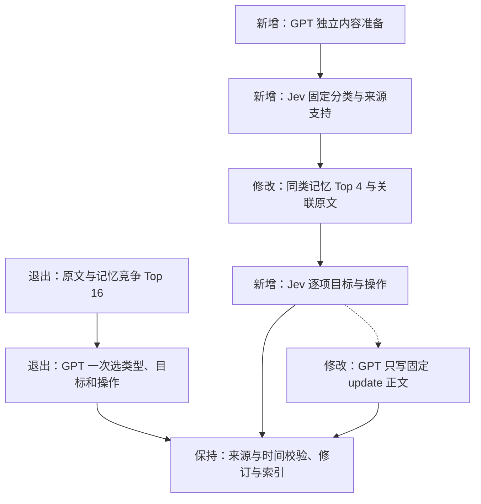

# G05 Add 局部架构 diff

## 修改边界

本次实现用户确认的分阶段 Add：固定类别选择 → 同类相似记忆召回 → 独立内容的目标与操作选择。GPT-4o-mini 准备内容并生成已确认更新的正文；Jev 通过 Choice/Noul 提供判断。API 合同、Search、数据库六张表、图关系和冷热规则保持现有版本。

生产链路删除旧 extract/动态命令提示。旧命令例子转为测试夹具，验证已有执行合同。每条来源继续完整保存；不确定分类、找不到合法目标或校验仍失败时记录内部处置，其他操作独立提交。

## Jev 输入与判断

分类状态只包含一个独立断言、本次用户来源和该断言引用的必要上下文。每批最多 4 个独立状态，问题明确引用 items[index]，各题独立判断。

操作状态包含已选类别、新断言、同类候选具体内容及原文。目标 new 表示候选均未匹配；uncertain 表示身份未确定。候选相似度只用于召回。程序根据所选目标读取其操作答案并绑定真实记忆 ID，GPT 更新输出只允许修改 content。

来源支持 Noul 使用超过 0.5 的试验门槛；本轮记录原始分数、类别分布、目标概率与处置。置信度用于审计，不宣称概率已校准。

## 调用预算与恢复

每处理单元：GPT 内容准备一次、Jev 分类与选择两轮逻辑判断、存在 update 时 GPT 内容生成一次。准备和内容生成共享一次修正。Jev 每批最多 4 项、状态最多 24,000 字节；实 HTTP 调用数量取决于批次，最终报告按物理调用计数。分类与选择之间的检索由程序执行，有历史的每个断言最多一次查询向量调用。

阶段缓存复用准备、分类、候选、选择及正文结果。索引失败继续索引。批次故障保留已完成独立答案。超过输入预算的状态保留原文，并记录 state_budget_exceeded。

## 验收

1. Choice 接口：独立合成英文及中文分类、匹配、操作、无匹配及选项换序，记录合同和预期一致性。
2. 离线：来源绑定、同类召回、独立操作、修订保留、共享修正、超预算、无效答案和阶段续跑。
3. 完整 Golden：159 个 RHELM 回合、13 道已知开发回归题，加 4 条生命周期输入与 3 道查询；严格原文证据计分。
4. 与 G02 v2 历史结果对比召回、完整命中、MRR、类别／操作分布、修正次数、错误更新审计及延迟。

G02 到当前版本已包含 G03 Search 修复及 G04 合成例子调整。历史分数对比同时包含这些变化，结论区分 Add 观察与整链路成绩。RHELM 没有内部类别及更新目标的标准标签；分类数量不能当作分类准确率，错误更新需要逐条核对新原文与旧内容。
