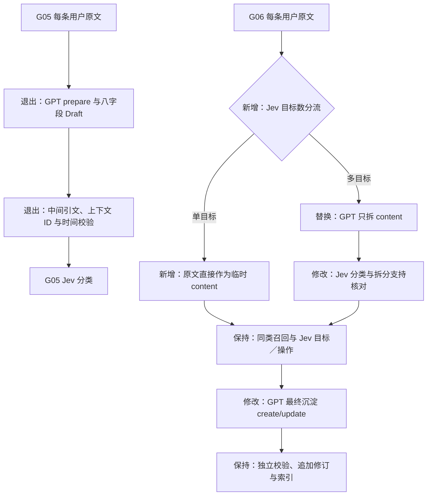

# G06 Add 架构 diff：分流后按需拆内容

日期：2026-10-13。范围：Add 前置输入、最终内容生成及检查点；Search、模型配置、数据库六表、冷热与修订规则保持现状。状态：代码实现及离线验证；本轮付费调用 0，Golden 未重跑。

## 局部变化



退出旧 prepare、PreparedPlan、PreparedRepair、Draft 及准备阶段修正路径，原因是中间产物只承担内容拆分。正式记忆的字段在类别和操作固定后填写，程序直接绑定原始来源。

## 临时内容与正式记忆

```json
{"items":[{"content":"昨天检修三号水泵。"},{"content":"明天检查五号水泵。"}]}
```

拆分只返回上述结构。程序为每项分配 item_id，继承同一条原文 ID、message_at 和 created_at；程序保持原文完整。消息时钟用于计算相对日期，最终每项分别确定 event_at 或 valid_from/valid_to。原文中的两次活动可以得到不同发生时间。

同一会议的日期和地点变更作为一个目标；取消行为和被取消的聚会作为一条记忆。拆分保留“昨天／明天”等词和指代所需信息，最终写入才解析时间并绝对化内容。

正式写入 GPT 返回 item_id、content、objects、time_expression、end_expression、status、impact。程序固定类别、操作、目标、原文 ID、原文支持片段及解释上下文。每项时间同时核对其临时内容和原始消息，其他项的日期只能作为该其他项的时间依据。时间无法确定时使用未知，内容继续保存。

## 调用与故障边界

| 分支 | Jev 逻辑阶段 | GPT 逻辑生成 |
| --- | --- | --- |
| 单目标 create/update | 分流与条件分类 → 目标／操作，通常 2 轮 | 最终写入 1 次 |
| 多目标 create/update | 分流 → 拆分后分类 → 目标／操作，通常 3 轮 | content 拆分 1 次＋最终写入 1 次 |
| raw_only/uncertain | 分流 1 轮 | 0 次 |
| keep/retract | 按对应目标数量判断 | 最终写入 0 次，多目标可能已有拆分 |

分流请求包含单目标类别和必要上下文的条件问题，程序只消费适用分支。多目标分类请求复用来源支持、整体覆盖和必要上下文问题，保持额外核验调用为 0。语义核对超过 0.5 的工程门槛仍需真实数据校准。

拆分与最终写入共享最多一次业务修正。多项时有效内容独立保留；整体覆盖未确认会记录风险，原文承接遗漏内容的检索。Jev 每批最多 4 项、状态最多 24 KB，物理请求按批计数。GPT 传输重试与业务修正分别统计。

所有新阶段及修正结果保存在 requests 原有 JSON。已完成请求继续幂等；索引失败只恢复索引，召回失败复用前置结果。当前管线遇到未完成的 G05 判断缓存会明确拒绝版本混用；旧运行可用其冻结代码恢复，现有数据库和结果保持原样。

## 验收标准

1. 单目标跳过 GPT 拆分，多目标输出只有 content，旧准备 Schema 退出生产。
2. 原始来源由程序绑定；模型修改来源／类别／目标的额外字段独立拒绝。
3. 各项发生时间分别处理，消息时钟原样继承；单次取消保留两处日期和一条行为。
4. 合法兄弟项、追加修订、用户隔离、原文保底和已确认日期保持可用。
5. 共享修正最多一次；修正结果在中断恢复后复用，重复请求与索引恢复维持稳定 ID。
6. 真实 Golden 的召回、分类、错误更新与耗时需要独立授权运行；离线通过数只代表程序合同。

固定选项及同次请求的条件问题设计参照 [TypeSafe Choice](https://docs.typesafe.ai/primitives/choice) 和 [函数调度示例](https://docs.typesafe.ai/cookbooks/function_calling)。
