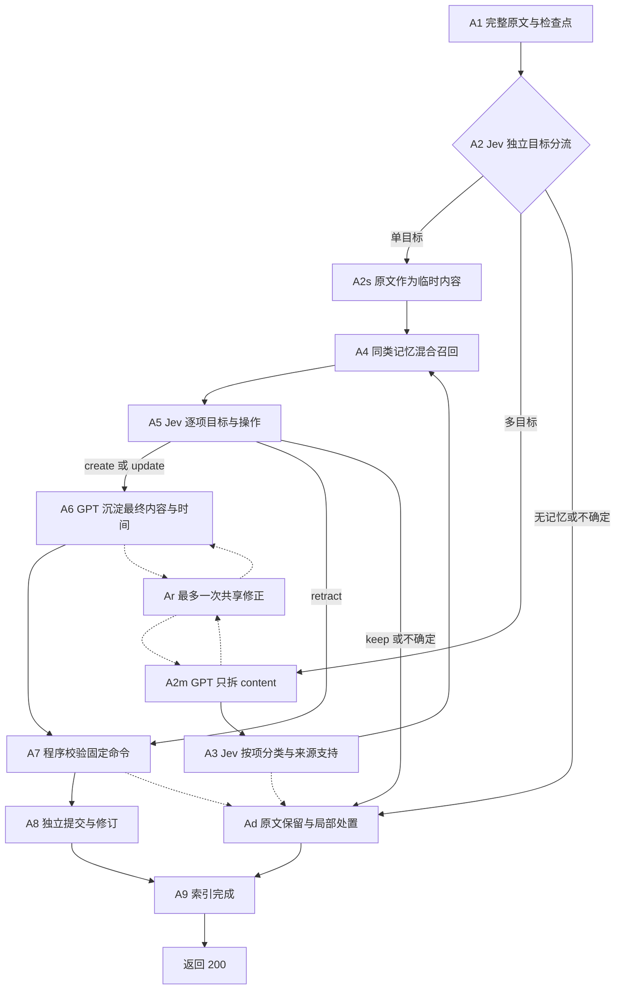
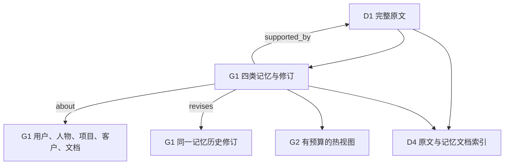

# G06 当前架构：Jev 分流与内容级拆分

状态：Add 先由 Jev 判断独立目标数量；单目标使用原文，多目标才由 GPT 拆 content。共用已批准的 6 张物理表；Search 保持 G03 实现。主力文本模型 GPT-4o-mini；Jev 判断分流、类别与目标／操作，Jev 重排证据。局部 diff 见 architecture-changes/g06-route-content-split.md。本版完成离线验证，真实模型效果仍待实验。

拆分使用独立合成例子，输出只有 items[].content。来源编号、原文和消息时钟由程序绑定。当前生产链路已移除 G05 prepare、Draft 和准备修正 Schema；历史合成命令保留为测试侧执行合同样例。

## Add

A1 保存完整消息、请求指纹及逐阶段检查点。A2 读取本次用户原文及最多 3 条解释上下文，以 single/multiple/raw_only/uncertain 分流。目标指可独立保存／更新的记忆；同一会议同时改日期和地点仍为单目标，取消行为与被取消的聚会保持同一条。单目标类别及必要上下文在同次 Jev 请求中预先判断，程序只消费单目标分支。单目标完整原文直接成为临时 content；多目标才调用 GPT，输出最多 24 条 content。

A3 对多目标按项选择 event/fact/preference/experience，raw_only/uncertain 保留原文。来源支持、拆分整体覆盖及必要上下文问题合并在现有分类批次中。来源支持概率超过 0.5 才进入结构化处理；整体覆盖未确认时记录遗漏风险，已支持项继续独立处理，原文提供剩余内容的检索底座。必要上下文概率超过 0.5 时，程序按输入位置绑定实际消息 ID；这些门槛是待校准的工程选择。

A4 按所属用户、历史可见时间及已选类别过滤记忆索引，再执行 BM25＋向量召回，最多 4 个独立记忆；每个候选携带稳定 ID、具体内容与对应原文摘录。原文通过来源关系给出，检索名额由记忆占用。

A5 每个独立断言使用目标 Choice 和候选操作 Choice。目标包含各候选、new、uncertain；候选操作包含 update/retract/keep/different/uncertain，新目标包含 create/keep/uncertain。模型同时评价各候选分支，程序只消费所选目标对应的答案。目标与操作冲突时保留原文并记录处置。

A6 在存在 create/update 时按批生成最终记忆。模型输出 item_id、content、objects、time_expression、end_expression、status、impact；类别、操作、目标和来源由程序固定。沉淀依据始终是原文，临时 content 用于聚焦目标。每条记忆从自身陈述和原文确定时间，消息时间是相对时间参考。同一目标的多项更新传入前序断言，保持仍成立的内容。retract 使用程序固定命令，keep 保持原记录。

A7 校验目标、类型、对象及每项时间。程序将可唯一还原的拆分内容复制为原文支持片段，其他情况保留整条用户原文；程序绑定原文 ID 与通过核对的解释上下文，模型输出合同中省去来源 ID、上下文 ID 和逐字引文。时间表达需由当前项及原文共同支持。A8 每项独立提交，更新追加修订。A9 等待原文及接受的记忆索引完成后返回。

Ar 是拆分与最终写入共享的一次修正。临时内容仅检查结构、非空与重复；语义支持由分类请求中的 Jev 判断。最终仅时间字段无法解析时局部降级，其他有效内容及可确定时间保留。分流、拆分、分类、候选、选择、最终结果和修正结果都保存在 requests 原有 JSON 检查点中。向量或初始写入供应商失败后，重发相同请求复用完成阶段。Jev 批失败、超预算或不确定时保留原文并记录原因。G05 未完成判断使用对应冻结运行代码恢复，当前管线核对检查点版本。

## 统一图与冷热

四类共用 Memory：preference、fact、event、experience。Profile 在 G01 中由关于用户的有效偏好和事实／条件组成工作视图。对象由 source 支持的名称及所属用户生成稳定 ID。实体别名和语义重复识别仍需真实数据验证。

热视图按 pinned、有效高影响条件、待完成计划、持续背景、近期确认／读取及时间排序。Search 背景先限定有效 preference/fact，再分配最多 hot_limit 条。条件卡携带状态；计划经过目标日期仍保持计划。访问时间与确认时间分开；未来查询访问记录不会影响历史视图。冷区继续索引，过期和撤回记忆保留历史。about 边按修订保存来源，历史查询继续读取当时可见关系。

event_at 表示本条事件陈述的主要时间，声明状态说明计划、发生或取消。valid_from/valid_to 表示持续记忆区间；缺失生效日期时，用户声明的消息时间作为已观察成立时间。observed_at 是来源时钟，created_at 是系统写入时间。其他有依据的相对日期可在具体内容中转为绝对日期。时区缺省采用 UTC；日历表达能力当前覆盖 ISO、中文年月日、英文及中文的今天／昨天／明天，其他表达进入共享修正或未知时间处置。

模型参数中的字符串空值在校验入口规范为 JSON 空值，目标身份及时间校验共用这一条解析路径。日历解析支持英文月份与日序数、今晚／昨晚及本日上午等日粒度表达；月份省略年份时沿用来源／查询时钟年份，跨年歧义仍需明确年份或历史锚点。支持的相对日表达同时用于日期字段和内容绝对化。两个时间字段均无法解析时局部降级为未知，来源与内容继续独立校验。

## Search

S1 统一搜索所有可见原文和记忆修订，冷热均可达。G3 从命中来源反查记忆，再读取明确人物／项目等对象关联的候选，按问题筛选，最多 graph_limit 条；宽泛的 self 所属关系只提供组织信息。补搜的新命中也可执行一次同样的有界读取。

S2 使用索引保存的原文窗口定位连续摘录，合并同回合的来源、窗口和记忆修订。查询、当前条件及证据共同计入 JSON 字节预算；候选池继续供后续重排。持续偏好与事实／条件从热视图提供小背景，最多 context_bytes。S3 同一次调用选择相关背景和最多两步补搜，原问题继续保留。

S4 支持独立日期、同日、之前／之后、first/latest、前后最多 3 天。日期绑定问题表达、已展示来源或 anchor_step 指定的前一步唯一时间。依赖结果时间有歧义时记录诊断。新命中来源加入可用来源集。参考时钟只计算相对日期。无法确认范围时保留基础结果并执行有诊断的词法补搜；数目及时间先后属于有界候选覆盖。

S5 以原始用户回合合并来源并集、命中窗口和各条记忆修订。每个渠道最多 40 条混合检索和 12 条图邻域，基础与最多两路补搜合并后完整进入 Jev，自然上限 156 文档。S6 在同一批 Jev 请求中获取支持度及时间查询的活动匹配度。S6t 对活动核对概率达到 0.8 的有界候选执行 first/latest；活动核对不完整时标明未确认并保留基础结果。0.8 是冻结的保守工程阈值，语义效果由 Golden 检验。S7 将已确认的时间选择保留到最终 Top K，返回实际来源日期、原文、各修订状态及有预算相关背景。Jev 失败／部分批失败保持原问题基础来源顺序，再追加补搜来源。Search 交付证据。

S3 每个工具步骤独立校验；有效背景选择和独立步骤继续执行。错误步骤及其依赖步骤记录局部处置。S4 选择消息时间锚点时，可以直接使用已选来源的实际消息时间；等价的 ISO 时间经元数据核对后接受，额外编造的时分秒继续拒绝。

## 模块、文件与预算

| 模块 | 文件 | 输入与输出 | 调用预算 |
| --- | --- | --- | --- |
| A1、A8、A9 | engine.py、storage.py | 请求与整条来源 → 检查点、独立记录、索引 | 写入与索引完成后返回 |
| A2m、A6、Ar | providers.py、models.py、add_judgments.py | 按需 content 拆分；固定 create/update 最终生成 | 单目标省去拆分，多目标按需一次拆分；按需一次写入；共享一次修正 |
| A2、A3、A5 | jev_choices.py、add_judgments.py | 独立目标分流、类型、来源支持、目标与操作 | 单目标通常两轮；多目标通常三轮；每批最多 4 项、状态最多 24 KB |
| A4 | retrieval.py、engine.py | 同类记忆 → 最多 4 条候选与原文 | 每个有历史的断言一次向量查询 |
| A7 | engine.py、clock.py、add_pipeline.py | 固定命令 → 接受或局部处置 | 程序计算 |
| G1 | models.py、storage.py | 具体内容、对象、来源 → 独立记忆及三类边 | 共用 6 张表 |
| G2 | heat.py | 有效记录与查询时钟 → 最多 24 条热视图 | 程序计算 |
| D4、S1 | retrieval.py、storage.py | 原文／记忆 → 全图混合候选 | 基础最多 40 文档 |
| G3 | engine.py | 命中记录 → 来源与明确对象邻域 | 一层、每次最多 12 文档 |
| S2 | engine.py | 原文卡与当前背景 → 决策状态 | 全状态 24000 字节，背景最多 4000 |
| S3、S4 | providers.py、engine.py | 问题与证据 → 最多两步补搜 | 一次 GPT，时间程序计算 |
| S5、S6、S7 | engine.py、providers.py | 来源去重候选 → 排序证据 | 每条重排原文 6000 字节；Jev 每批 8 条、最多 2 并发 |

GPT SDK 隐式重试为 0，显式暂态重试最多一次并受剩余预算约束。Jev 批次直接退回基础顺序，DashScope 索引失败交由请求检查点续跑。预算为同步合作式截止时间，各外部调用按剩余额度缩短超时。

## 第一版边界

同一记忆身份、类别及操作由 Jev 的受限问题判断，GPT 负责具体文字。概率和合法 JSON 说明接口契约通过，语义正确性由原文与修订人工审计。追加修订保护历史，错误选择仍可能影响当前视图。候选遗漏、类型混淆、更新文字丢失细节及多阶段耗时属于本轮重点验收项。

数据库验收继续使用获批六表 Schema：原文、记忆、对象、关系、请求检查点与向量可持久化。事务回滚、用户隔离、历史修订、跨请求上下文、现有库保护、冷记忆检索和 SQLite 后端 HTTP 合同已有离线回归。本轮只在临时库验证；现有主库和历史实验保持原样。验收记录见 verification.md。

图关系与冷热收益需固定同一记忆库做消融；宽泛事件组、自动 combine、额外语义核验、自动经验归纳和全量 Profile 独立筛选退出当前链路。增长测试后再决定词法缓存、向量索引与实体别名方案。已有 TraceWeave 项目保持不变。
