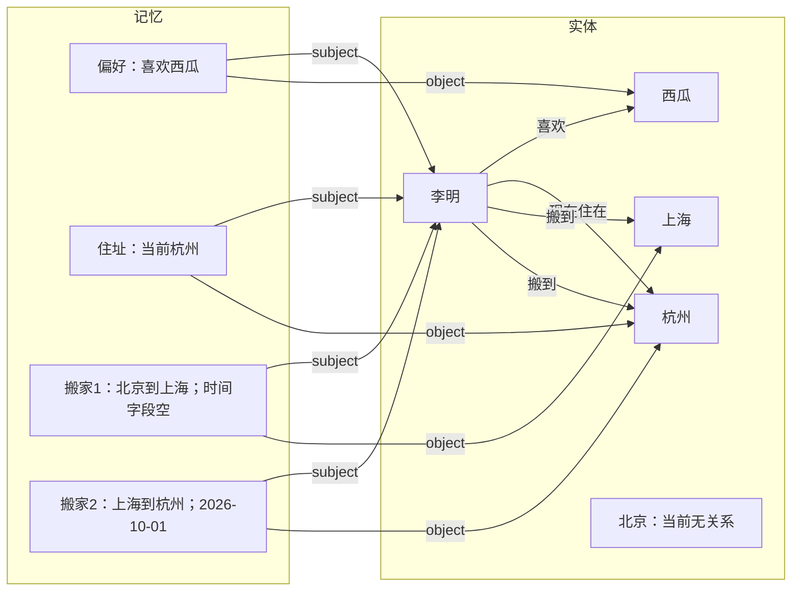

# G08 候选与联合维护图实验

2026-10-19。实现和离线程序合同验收完成，真实 Golden 完成。平均原文证据 Recall@10 从 G07 的 **73.50%** 升到 **76.07%**；实际图中仍有论元错配、请求模态和时间字段遗漏，语义可靠性保持实验状态。

## 实现与边界

写入使用 **GPT 提候选 → 程序按实体与全库补入口跨标签召回 → GPT 联合维护定稿 → 程序验证、生成关系及原子提交**。普通单元两次 GPT，空候选一次；共享一次输出修正。跨请求重发只重执行尚未验证的阶段，额外成本单独记录。

Source、稳定记忆 ID、追加修订、六张表、HTTP 协议、原文索引、混合检索、Search 决策和 Jev 重排保留。GraphObject 增加身份及带来源的别名；Revision 增加角色、开放实体断言、字面值属性、跨记忆联系、模态和时间作用域。程序从支持修订生成边，历史图按可见修订读取。Jev Add 分类／目标选择及固定操作后的旧写作路径已移除，由统一两阶段流程承接。

模型选择来源 ID，程序复制原文；编辑继承候选证据。模型边界用 S/M/E 短引用表示来源、旧记忆和既有实体，程序还原真实 ID。可选图元数据的无效端点、歧义引用和无来源对象写入审计处置。候选覆盖、来源所有权和维护目标继续严格校验。同一目标、相同时间状态的兼容补充合为一次最终修订。

本轮使用有界主体召回；边际效益递减的广度搜索保持后续讨论。生产代码使用一条当前 Add 路径。旧实验库和代码快照独立保留；现有旧格式数据通过明确的原文重放流程进入新库。

## 输入、版本和验证口径

- 冻结 RHELM David 的已知开发集：159 回合、42 个主 Add、13 道检索题；另外 4 条生命周期输入和 3 道查询。
- 声明模型：gpt-4o-mini；Search 重排 jev-1.13.0；text-embedding-v4、1024 维。Top K=10，配置和输入哈希在结果中保存。
- 离线：**192 passed、0 skipped，9.89 秒**；第三方 TestClient 弃用提示一条。覆盖真实 SQLite、HTTP、阶段恢复、原子提交、身份、历史图与来源隔离。完整 David 的计划及历史计分也用只读数据完成离线校验。
- 完成 46 个逻辑 Add，共 **56 次数据写入 HTTP 尝试**，包含 10 次 503；另外执行了幂等与冲突协议检查。13+3 道查询均 HTTP 200，生命周期预期原文证据 Top 1 为 **3/3**。
- 主实验在 106 条输入、4 道查询后，由冻结 V12 切换到冻结 V13，修复“失败阶段重发缺少上一轮校验反馈”。已验证记录和阶段复用，原始失败计划保留。正常模型协议和 Search 逻辑保持一致；两个代码指纹、输入哈希和切换点记录于 `result.json.code_transitions`。这是一轮有明确修复记录的开发回归。
- 总墙钟约 **57.80 分钟**，包含故障重试和修复等待；逻辑 Add 耗时按相同请求的各次 HTTP 执行时长相加，排除修复等待。
- 数据库恰好六张表，`quick_check=ok`，图悬空边为 0。当前工作区未 commit。

## 与 G07 的同口径对照

| 指标 | G07 | G08 |
|---|---:|---:|
| 平均原文证据 Recall@10 | 73.50% | 76.07% |
| 全部证据命中 | 7/13 | 9/13 |
| 至少一条证据命中 | 13/13 | 11/13 |
| MRR@10 | 0.7256 | 0.7372 |
| 主集逻辑 Add 平均，42 请求、含重试 | 44.07s | 62.14s |
| 主集 Search 平均 | 12.73s | 11.02s |

主集 Add 平均增加约 **41.0%**。包含生命周期的全 46 请求合计口径为 G07 **41.38s**、G08 **57.98s**；此前常见的 G07 41.38 秒属于这个口径。

这里衡量实际返回原文的证据召回。最终答案准确率和 AML 官方分数需要各自评测。13 题是已知开发集，历史对照同时包含写入、维护、图和视图的变化。

### 逐题

| 题号 | 类型 | G07 Recall@10 | G08 Recall@10 |
|---|---|---:|---:|
| fact_ef36b7 | fact | 100.00% | 100.00% |
| hallucination_ef6a39 | hallucination | 22.22% | 22.22% |
| aggregation_30220c | aggregation | 100.00% | 100.00% |
| misleading_a952ee | misleading | 50.00% | 0.00% |
| temporal_6c5283 | temporal | 100.00% | 100.00% |
| aggregation_e1dfb2 | aggregation | 100.00% | 100.00% |
| hallucination_87dba1 | hallucination | 100.00% | 100.00% |
| fact_8f6beb | fact | 50.00% | 0.00% |
| aggregation_665da1 | aggregation | 100.00% | 100.00% |
| fact_5a7990 | fact | 50.00% | 100.00% |
| temporal_e1f411 | temporal | 50.00% | 100.00% |
| temporal_f67ca7 | temporal | 100.00% | 100.00% |
| misleading_e91747 | misleading | 33.33% | 66.67% |

## 同库图扩展对照

两组从同一个最终库分别复制，采用同一冻结 V13 Search、相同查询顺序与数据可见规则；保留热背景。原始数据库指纹保持不变。

| 配置 | Recall@10 | 全部证据命中 | MRR@10 |
|---|---:|---:|---:|
| 图扩展开 | 76.07% | 9/13 | 0.7949 |
| 图扩展关 | 73.50% | 9/13 | 0.7051 |

关闭组的 `graph_documents` 总数为 0，开启组为 150。召回差异集中在 CrossFit 请求题：开启组 2/3，关闭组 1/3。两组生命周期均 3/3，查询错误为 0。每组仅一次重放，模型输出存在波动；本次观察到的 2.56 个百分点差异需要独立数据和重复实验进一步衡量。

## 实际图

| 范围 | 来源 | 实体 | 记忆 | 修订 |
|---|---:|---:|---:|---:|
| 主 RHELM 库 | 318 | 80 | 154 | 261 |
| 生命周期库 | 4 | 5 | 4 | 7 |
| 合计 | 322 | 85 | 158 | 268 |

导出共 **833 节点、1263 存储边**：实体角色 560、实体断言 308、来源支持 285、修订连接 110。当前可见版本共有 189 条实体断言。跨记忆 `related` 边为 **0**，当前模型尚未实际建立事件与状态等记忆之间的显式联系。来源引文匹配、别名来源和悬空边检查均通过。

下面是生命周期库实验结束时的实际当前投影；节点和角色来自记录。北京实体保留在库中，当前事件角色未保留其起点连接。

实际生命周期保留：西瓜偏好一条独立记忆；住址上海→杭州两版；第一次搬家计划 9/22→改为 9/24→完成三版；第二次搬家独立一条。第一次搬家最终正文明确 9/24，`event_at` 仍为空。原文检索可返回正确证据，结构化时间与事件起点角色仍有遗漏。

## Bad case 与链路定位

1. **实体断言论元错配。** 实际修订 `rev_4b73ec9f7dd4ae11d0113d8b` 的正文描述 Jasper 比较水果价格，投影为 `self —compares→ Jasper`。候选／正文已经包含正确行动者，联合维护生成断言时选择了错误主客体。程序校验了端点与来源，尚未验证关系命题的语义支持。
2. **请求模态。** 具体的“生成三句政策诉求版本”请求被存成 `stated / ongoing` 内容。RHELM 包含大量文档编辑与方案整理，任务意图、草案状态和个人长期事实需要清晰区分。直接保留指令形式会影响后续背景选择。
3. **关系对象错配。** 关于 LinkedIn 消息有意义的记忆生成了 `self —is meaningful to→ Invisible Barriers`，正文中的消息与文档对象发生混淆。
4. **早晨步行请求全漏。** 原文保存了此前晨走扭伤脚踝、冰面滑倒的经历；搜索规划转而查未来一天的通用步行建议，两条预期来源未进入最终候选。该题由 G07 1/2 退到 0/2，体现历史经验检索与新行动时间的区分缺口。
5. **设备切换题全漏。** iPhone 故障后使用哪台设备完成工作，G07 1/2、G08 0/2。完整候选与排序定位保存在 `analysis.json`，这次记忆重组未稳定覆盖该跨回合线索。
6. **虚假活动前提覆盖不足。** 1 月 20 日所谓公开预算工作坊题维持 2/9；部分来源经图通道进入候选后被低分排序丢弃，另外部分未入池。补搜沿用问题中的活动前提，并按事件时间查同日；当天讨论内容及纠正前提的证据覆盖不足。
7. **时间与事件角色。** 第一次搬家完成日期在正文和原文可见，结构化 `event_at` 为空；两次搬家的当前角色仅包含行动者和目的地，起点未进入当前投影。三道返回证据检查均命中，图字段仍需独立审查。

这轮实现了实体关系和版本投影，并得到小幅证据召回增益。可靠图推理还受到上述生成质量限制。事实、事件和经历的维护身份以及来源模态，继续决定实际语义质量。

## 可审计文件

- [完整结果](../.local-data/golden-g08-20261019-v12/result.json)
- [逐题遗漏定位](../.local-data/golden-g08-20261019-v12/analysis.json)
- [同口径 G07 对照与完整性核查](../.local-data/golden-g08-20261019-v12/audit.json)
- [同库图扩展结果](../.local-data/golden-g08-20261019-v12/paired-graph-search.json)
- [全部真实节点和关系](../.local-data/golden-g08-20261019-v12/graph/graph-data.json)
- [图数量与所有者统计](../.local-data/golden-g08-20261019-v12/graph/graph-summary.json)
- [已保留的真实语义错误修订与原文](../.local-data/golden-g08-20261019-v12/observed-bad-cases.json)

V1–V11 调试失败现场及 V12/V13 冻结快照继续保留。当前 Git 工作区保留为未提交，数据库沿用已授权六表。
